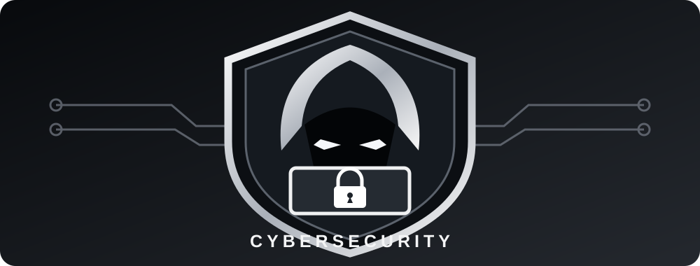

# Joseph Gonzalez

### Cybersecurity | Information Technology | Software Engineering

**CompTIA Security+ Certified | U.S. Army Reserve Officer | Federal Professional**

Graduate Computer Science Student | Polytechnic University of Puerto Rico

---

## 👨‍💻 Professional Profile

I am a CompTIA Security+ certified professional, U.S. Army Reserve officer, and graduate Computer Science student with experience in information systems, technical troubleshooting, cybersecurity, and operational leadership.

My technical background includes Windows workstation imaging, network connectivity, communications systems, software development, and independent cybersecurity laboratory research.

I currently perform battalion S6 functions in the Army Reserve, supporting communications and information systems readiness. My professional goal is to continue developing my technical expertise in cybersecurity, networking, and software engineering.

---

## 🚀 Featured Projects

### 🛡️ Ethical Hacking Labs

**Cybersecurity Research | Threat Analysis | Security Awareness**

A growing collection of hands-on cybersecurity laboratories covering social engineering, mobile security, browser privacy, and defensive analysis.

Projects document the lab environment, methodology, evidence, observed results, and security recommendations.

**Current Labs:**
- SEToolkit — Credential Exposure
- AndroRAT — Android APK Sideloading
- Seeker — Browser Location Disclosure

---

### 🥋 SKIF Karate Puerto Rico

**Web Development | Community | Martial Arts**

An independent project supporting the digital presence of the Shotokan Karate-Do International Federation community in Puerto Rico.

Combines technical development with my long-standing involvement in karate and volunteer instruction.

---

### 💻 ZeroDay Tech Labs

**Independent Technology Projects | Cybersecurity | Software Development**

A personal technology project repository focused on technical experimentation, cybersecurity education, and practical computing applications.

Serves as a space for independent development, experimentation, and continued technical learning.

---

## 🛠️ Technical Skills

### Operating Systems & Development

### Cybersecurity & Networking

**Additional Experience:** Windows Deployment, IT Troubleshooting, Network Connectivity, Technical Documentation, Communications Systems, and Security Analysis.

---

## 🎓 Education

**Master of Science in Computer Science**

Polytechnic University of Puerto Rico

Graduate GPA: **3.6**

Areas of interest include software engineering, cybersecurity, networking, and information systems.

---

## 🏅 Certifications

---

## 🎖️ Leadership & Professional Experience

**U.S. Army Reserve | Military Police Officer / Battalion S6 Functions**

Experience in military leadership, operational planning, personnel supervision, technical coordination, and communications readiness.

- Led and supervised a 39-Soldier military police platoon.
- Supported law enforcement operations during overseas mobilization.
- Perform battalion S6 duties involving information systems, communications, and technical readiness.
- Completed supervised technical training involving Windows deployment, network cabling, and communications systems.

---

### Building Technical Experience Through Practical Projects

*Cybersecurity • Software Engineering • Networking • Continuous Learning*

