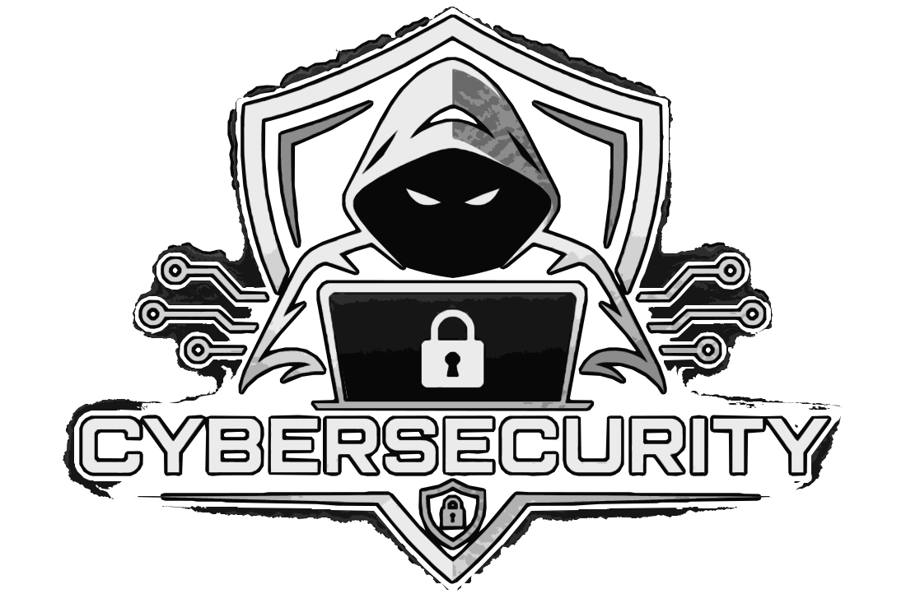

# Joseph Gonzalez

**Cybersecurity · IT & Networking · Software Engineering**

  
  

I troubleshoot Windows systems and networks and build web applications. In my security labs, I compare what the user sees with what the system records. In the credential exposure lab, for example, the browser showed a sign-in error while the server log recorded the test credentials.

---

## 🚀 Featured Projects

### 🛡️ Ethical Hacking Labs

**Cybersecurity Research | Threat Analysis | Security Awareness**

A growing collection of hands-on cybersecurity laboratories covering social engineering, mobile security, browser privacy, and defensive analysis.

Projects document the lab environment, methodology, evidence, observed results, and security recommendations.

**Current Labs:**
- SEToolkit - Credential Exposure
- AndroRAT - Android APK Sideloading
- Seeker - Browser Location Disclosure

---

### 🥋 SKIF Karate Puerto Rico

**Web Development | Community | Martial Arts**

An independent project supporting the digital presence of the Shotokan Karate-Do International Federation community in Puerto Rico.

Combines technical development with my long-standing involvement in karate and volunteer instruction.

---

### 💻 ZeroDay Tech Labs

**Independent Technology Projects | Cybersecurity | Software Development**

A personal technology project repository focused on technical experimentation, cybersecurity education, and practical computing applications.

Serves as a space for independent development, experimentation, and continued technical learning.

---

## 🛠️ Technical Skills

### Operating Systems & Development

### Cybersecurity & Networking

**Additional Experience:** Windows Deployment, IT Troubleshooting, Network Connectivity, Technical Documentation, Communications Systems, and Security Analysis.

---

## 🎓 Education

  

My graduate studies focus on the design and security of software and information systems.

---

## 🏅 Certifications

---

## 💼 Professional Experience

My background includes federal service and military leadership, with experience in operational coordination, technical support, documentation, and team development.

I have worked with Windows deployment, communications systems, equipment readiness, and technical troubleshooting in structured professional environments.

*Operational assignments, organizational details, system configurations, and other nonpublic information are intentionally excluded from this public portfolio.*

---

